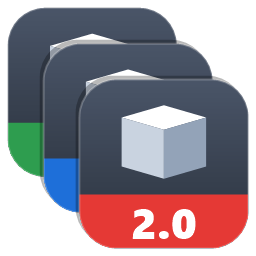
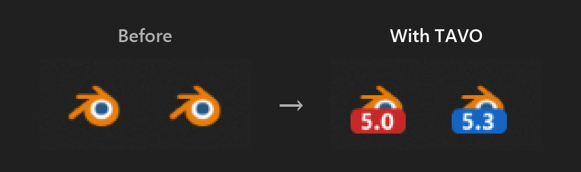
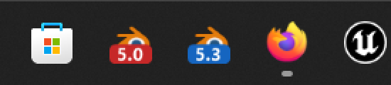
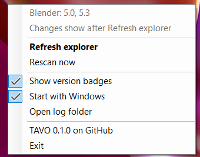

<p align="center">
  
</p>

<h1 align="center">TAVO</h1>

<p align="center">
  <b>Taskbar App Version Overlay</b><br>
  Version badges on your Windows taskbar pins, when you keep more than one version of an app.
</p>

<p align="center">
  <a href="https://github.com/thefoofighter/TAVO/releases/latest"></a>
  <a href="https://github.com/thefoofighter/TAVO/actions/workflows/ci.yml"></a>
  
  
  <a href="LICENSE"></a>
</p>

<p align="center">
  
</p>

## Why

Do you pin Blender 4.2 and 5.0, two Unreal Engine builds, or several SDK tool versions? Then your taskbar shows identical icons, and you hover over each one to find the right version.

TAVO puts the version number on each icon. It does this only for apps that have two or more versions pinned. Other pins stay as they are.

## Features

- **Automatic.** TAVO watches your pins. A badge appears when you pin a second version of an app. It goes away when you unpin back to one.
- **Short labels.** Each label is `major.minor`, for example `5.0` and `5.3`. A version gets a third number only when another pinned version has the same `major.minor`: `5.3.1`, `5.3.2`, `5.8`. Prereleases with equal numbers get a short tag: `4.2a3`, `4.2a4`.
- **One color per version.** Inside an app, each version gets its own badge color.
- **Correct grouping.** A running app shows under the pin of its own version. Some apps (for example Unreal Editor) report the same taskbar ID for every version. TAVO gives each version its own ID.
- **No code injection.** TAVO does not hook into Explorer or into other apps. It edits the pinned shortcuts and uses Windows shell interfaces.
- **Reversible.** Turn the badges off, and TAVO puts every original icon back.
- **Small footprint.** One tray app. It starts with Windows and needs no installer.

<p align="center">
  
</p>

## Install

1. Download `TAVO-<version>-win-x64.zip` from the [latest release](https://github.com/thefoofighter/TAVO/releases/latest).
2. Extract `TAVO.exe` to a folder that you keep, for example `%LOCALAPPDATA%\Programs\TAVO`.
   "Start with Windows" uses this location.
3. Start `TAVO.exe`. The TAVO icon appears in the notification area (it can be under the `^` arrow).
4. Right-click the TAVO icon and select **Refresh explorer**. The badges appear.

> [!NOTE]
> The release is not code-signed. Windows SmartScreen can show "Windows protected your PC". Select **More info**, then **Run anyway**. You can also build TAVO from source (see below).

`TAVO-<version>-win-x64-framework-dependent.zip` is a smaller download (under 1 MB). It needs the [.NET 10 Desktop Runtime](https://dotnet.microsoft.com/download/dotnet/10.0).

## Use



Right-click the TAVO icon in the notification area.

| Item | What it does |
|------|--------------|
| *(status lines)* | Shows the badged apps, and a note when changes wait for a refresh. |
| **Refresh explorer** | Resets the shell icon cache and restarts Windows Explorer, so the taskbar shows the current badges. Open File Explorer windows close. |
| Rescan now | Scans the pins now. TAVO also scans when pins change, and every 10 minutes. |
| Show version badges | Clear this to remove all badges and restore the original icons. |
| Start with Windows | Starts TAVO when you sign in. On by default. |
| Open log folder | Opens `%LOCALAPPDATA%\TAVO`. |
| TAVO *x.y.z* on GitHub | Opens this page. |
| Exit | Stops TAVO. The badges stay on the pins. |

<br clear="right">

### When to refresh

The Windows taskbar does not reload a pin icon while it runs. After a badge change, TAVO shows a notification and makes **Refresh explorer** bold. Select it once to show the change. TAVO reminds you after the next sign-in if you have not done it.

## What TAVO changes on your PC

| What | Where | Undo |
|------|-------|------|
| Icon of pinned shortcuts (badged apps only) | `%APPDATA%\Microsoft\Internet Explorer\Quick Launch\User Pinned\` | Clear **Show version badges** |
| Taskbar ID of a pinned shortcut (only when two versions share one ID) | Same shortcuts | Clear **Show version badges** |
| Taskbar ID of running windows of badged apps | In memory, until the window closes | Close the window |
| Badge icons, settings (`state.json`) and log (`tavo.log`) | `%LOCALAPPDATA%\TAVO` | Delete the folder |
| Autostart entry | `HKCU\Software\Microsoft\Windows\CurrentVersion\Run\TAVO` | Clear **Start with Windows** |
| Shell icon cache, deleted on **Refresh explorer** (Windows rebuilds it) | `%LOCALAPPDATA%\IconCache.db` | Not needed |

TAVO needs no administrator rights. It does not use the network.

## Limits

- Tested on Windows 11 x64 only (build 26300). Windows 10 and Arm64 are not tested.
- Badges show after **Refresh explorer**, not at once (see [When to refresh](#when-to-refresh)).
- The grouping fix uses an undocumented Windows interface (`IApplicationResolver`). A future Windows update can break it. The badges do not depend on it.
- Only pins that start a program file (`.exe`) get badges. Store apps do not.
- Splitting versions that share one taskbar ID is implemented, but it was tested with Blender only.
- Do not start TAVO from a terminal inside a packaged (MSIX) app, such as some IDE or AI app terminals. Windows redirects TAVO's files and registry entries into that app's private storage, and Explorer cannot see them. Start TAVO from File Explorer or the Start menu.

## Troubleshooting

**No badges after I pinned a second version.** Select **Refresh explorer**.

**A pin shows an old or wrong icon.** Select **Refresh explorer**. It deletes the shell icon cache (`IconCache.db`) before it restarts Explorer, so Windows rebuilds the cache.

**I want to see what TAVO detects.** Run `TAVO.exe --plan` in a terminal. It lists your pins, the detected versions and the planned badges. It changes nothing.

**Something else.** Open the log (**Open log folder**, then `tavo.log`) and [open an issue](https://github.com/thefoofighter/TAVO/issues/new/choose). Include the log lines and the output of `TAVO.exe --plan`.

## Command line

| Command | Effect |
|---------|--------|
| `TAVO.exe` | Starts the tray app. |
| `TAVO.exe --plan` | Shows pins, versions and planned badges. Changes nothing. |
| `TAVO.exe --apply` | Applies the badges once, then stops. |
| `TAVO.exe --restore` | Restores all original icons, then stops. |
| `TAVO.exe --refresh-explorer` | Resets the shell icon cache and restarts Explorer. |
| `TAVO.exe --version` | Shows the version. |

`--apply` and `--restore` do not run while the tray app runs.

## Uninstall

1. In the TAVO menu, clear **Show version badges**, then select **Refresh explorer**.
2. Clear **Start with Windows**, then select **Exit**.
3. Delete `TAVO.exe` and the folder `%LOCALAPPDATA%\TAVO`.

## Build from source

Requires the [.NET 10 SDK](https://dotnet.microsoft.com/download/dotnet/10.0) on Windows.

```bash
dotnet test TAVO.sln -c Release
```

```bash
dotnet publish src/TAVO/TAVO.csproj -c Release -r win-x64 --self-contained -p:PublishSingleFile=true -p:IncludeNativeLibrariesForSelfExtract=true -p:EnableCompressionInSingleFile=true -o artifacts
```

[docs/how-it-works.md](docs/how-it-works.md) explains how TAVO finds pins, makes the badges and fixes the grouping. It also lists the Windows behavior it depends on.

## License

TAVO is free and unencumbered software released into the public domain. See [LICENSE](LICENSE) (The Unlicense).
